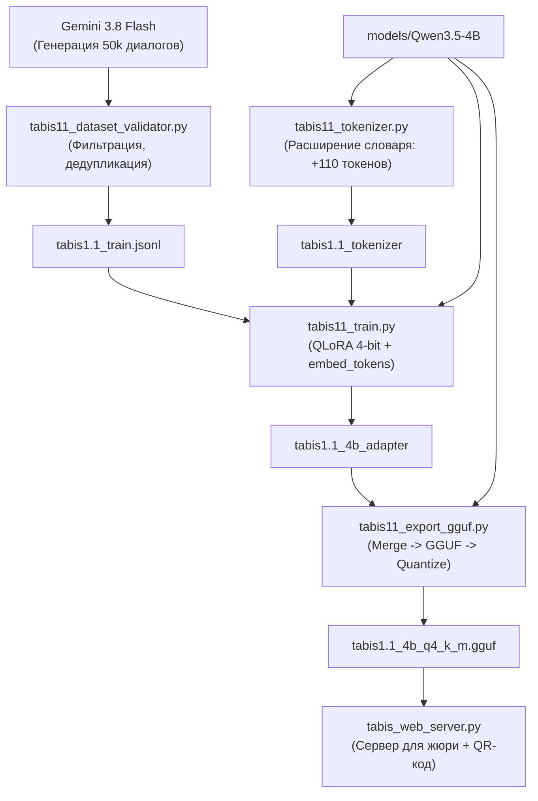

# НАУЧНО-ИНЖЕНЕРНЫЙ ПАЙПЛАЙН РАЗРАБОТКИ МОДЕЛИ «ТАБЫС 1.1» (TABIS 1.1 4B)
## И ПЛАН ПОДГОТОВКИ К МУНИЦИПАЛЬНОМУ ЭТАПУ (ДЕЙСТВИЕ: 30 ДНЕЙ)

> **Проект:** Разработка суверенной билингвальной языковой модели «Табыс 1.1» (tabis1.1-4b) для малоресурсного якутского языка (саха тыла)  
> **Автор разработки:** Николаев Сарыал Павлович, 11 класс, МБОУ «Намская улусная гимназия им. Н.С. Охлопкова»  
> **Научный руководитель:** Сидоров Николай Семенович  
> **Среда разработки:** Локальный стенд на базе NVIDIA GeForce RTX 5060 (8 ГБ VRAM)  
> **Целевое событие:** Муниципальный этап Всероссийской программы «Шаг в будущее» (ноябрь 2026 г.)

---

## 1. Анализ фундаментальных проблем Tabis 1.0 и концепция версии 1.1

По результатам предварительной защиты и 150 стресс-тестов версии `tabis1.0-4b` были вскрыты две коренные архитектурные причины лингвистических ошибок:

1. **Дефект обучающего датасета (Translation Paralysis):**
   * В версии 1.0 использовались параллельные книги и машинный перевод пар предложений («слово за словом»).
   * У модели отсутствовал опыт интерактивного диалога (Human-AI interaction), поэтому в свободной беседе она пыталась не отвечать собеседнику, а «допереводить» или дописывать текст как книгу.
2. **Феномен распада токенизатора на байты (High Byte-Level Fertility):**
   * В базовом токенизаторе Qwen символы `ҕ, Ҕ, ҥ, Ҥ, Ү` отсутствовали в словаре как самостоятельные единицы.
   * Слово `саҥа` дробилось на 4–6 субтокенов `[142, 98]`, заставляя модель угадывать байты UTF-8. Это приводило к зацикливанию (`4b 4b 4b...`) и лексическим галлюцинациям.

### Ключевые инновации Tabis 1.1:
* **Адаптация токенизатора (Vocabulary Extension):** Внедрение 110 специализированных якутских токенов (буквы + частотные аффиксы сингармонизма) со сжатием длины текста до 25.8%.
* **Фонетическая инициализация эмбеддингов:** Веса новых якутских букв инициализируются от родственных кириллических доноров (`ҕ` $\leftarrow$ `г`, `ҥ` $\leftarrow$ `н`, `Ү` $\leftarrow$ `У`) вместо случайного белого шума.
* **Масштабный диалоговый корпус (50 000 пар ChatML):** Разработанная матрица тем, имитирующая живое общение с носителем языка саха.
* **Обучение эмбеддингов в LoRA (`modules_to_save`):** Полная подгонка новых токенов под семантическое пространство Qwen.

---

## 2. Архитектура и пропорции обучающего датасета (50 000 диалогов)

| № | Категория | Доля | Кол-во диалогов | Описание и специфика |
| :-: | :--- | :-: | :-: | :--- |
| **A** | **Күннээҕи кэпсэтии (Бытовой диалог)** | **40%** | **20 000** | Живое общение: семья, школа, охота, рыбалка, погода, блюда якутской кухни, спорт, хобби. |
| **B** | **Култуура, устуоруйа уонна Саха сирэ** | **25%** | **12 500** | Олонхо, Ысыах, традиции, Ойунский, Аммосов, Кулаковский, улусы, география, Чысхаан. |
| **C** | **Тылбаас уонна быһаарыы (ru $\leftrightarrow$ sah)** | **20%** | **10 000** | Не просто перевод, а диалог: точный перевод + объяснение морфем, синонимов и культурного контекста. |
| **D** | **Үөрэх, логика уонна STEM** | **10%** | **5 000** | Решение математических задач, физика, биология Севера, логические загадки на якутском языке. |
| **E** | **Идентичность и безопасность** | **5%** | **2 500** | Автор Сарыал Николаев, Намская гимназия, отсутствие галлюцинаций, защита от взлома и джейлбрейков. |

---

## 3. Пошаговый технический регламент сборки Tabis 1.1



### Шаг 1. Адаптация токенизатора и словаря
Выполняется локально:
```powershell
python tabis11_tokenizer.py
```
* **Результат:** Папка `tabis1.1_tokenizer` с обновленным словарем (248 187 токенов). Буквы `ҕ, Ҕ, ҥ, Ҥ, Ү` и ключевые аффиксы закодированы как самостоятельные токены.

### Шаг 2. Генерация диалогов через Gemini 3.8 Flash
Пакетные промпты по 5 категориям:
```powershell
python tabis11_prompt_generator.py
```
Сгенерированные порции диалогов складываются в `raw_dialogues.jsonl`.

### Шаг 3. Валидация и фильтрация датасета
Автоматическое отсечение мусора, битых строк, иероглифов, зацикливаний и повторов:
```powershell
python tabis11_dataset_validator.py
```
* **Результат:** Чистые обучающий (`tabis1.1_train.jsonl`) и валидационный (`tabis1.1_val.jsonl`) файлы в строгом формате ChatML.

### Шаг 4. Обучение модели (SFT QLoRA 4-bit)
Обучение запускается на видеокарте RTX 5060:
```powershell
python tabis11_train.py
```
* **Особенности:** Используется 4-bit NF4 с оптимизацией `paged_adamw_8bit`. Параметр `modules_to_save=["embed_tokens", "lm_head"]` обучает новые якутские токены совместно с весами внимания.

### Шаг 5. Слияние адаптеров и квантование в GGUF
Финальный этап сборки готовой модели:
```powershell
python tabis11_export_gguf.py
```
* **Результат:** Файл `tabis1.1_4b_q4_k_m.gguf`, готовый к прямому переносу в LM Studio и веб-сервер.

---

## 4. План подготовки к Муниципальному этапу (Горизонт: 30 дней)

По итогам предварительной защиты устранены ключевые замечания экспертов. Подготовка структурирована по 4 спринтам:

### Спринт 1 (Дни 1–7): Генерация и очистка 50 000 диалогов
* Запуск отдельного потока с Gemini 3.8 Flash для нарезки 50 000 диалогов по 5 утвержденным категориям.
* Прогон через `tabis11_dataset_validator.py` (удаление шума, проверка наличия саха букв, дедупликация).
* Формирование итогового `tabis1.1_train.jsonl`.

### Спринт 2 (Дни 8–14): Обучение и квантование Tabis 1.1
* Обучение модели на RTX 5060 (2 эпохи, learning rate $2 \cdot 10^{-4}$, сохранение эмбеддингов).
* Слияние весов и квантование в Q4_K_M (`tabis1.1_4b_q4_k_m.gguf`).
* Прогон контрольного стресс-теста на 150 запросов для подтверждения ликвидации зацикливаний.

### Спринт 3 (Дни 15–21): Развертывание публичного сервера для жюри (Решение проблемы ввода ссылок)
* **Проблема:** Членам жюри неудобно вбивать ссылки вручную в браузер во время доклада.
* **Решение:** 
  1. Развертывание веб-демо `tabis_web_server.py` на бесплатном облачном сервере **Hugging Face Spaces** (Docker/Python) или с пробросом туннеля через Cloudflare/ngrok.
  2. Генерация динамических **QR-кодов** (прямой переход со смартфонов жюри на демо-чат модели «Табыс 1.1»).
  3. Создание резервного Telegram-бота для тестирования прямо из мессенджера без открытия сайтов.

### Спринт 4 (Дни 22–30): Визуальное оформление и ораторская подготовка
* **Устранение проблемы «я тараторю»:**
  * Составление поминутного тайминга на **ровно 7 минут** выступления.
  * Расстановка фиксированных пауз (3–4 секунды) на ключевых слайдах (сравнение с 368 моделями, формула QLoRA, замер скорости 89.18 ток/с).
  * Подготовка плотных карманных карточек спикера (Speaker Cue Cards) с опорными тезисами вместо чтения с листа.
* **Добавление живых скриншотов в презентацию:**
  * *Слайд 1:* Крупный QR-код на репозиторий и веб-демо для жюри.
  * *Слайд 9:* Скриншот окна инференса LM Studio с замером **89.18 ток/с**.
  * *Слайд 10:* Скриншот консоли обучения с падением Loss и распределением VRAM (2.8 ГБ).
  * *Слайд 11:* Визуальное сопоставление ответов (Side-by-side): «Было в 1.0 (зацикливание)» vs «Стало в 1.1 (чистый диалог на саха)».
  * *Финал:* Раздаточный буклет (1 страница А4) с QR-кодами на модель, исходный код и научный отчет.

---

## 5. Памятка спикера: 7 минут без спешки (Speaker Timeline)

| Минута | Слайды | Действие и слова спикера | Интонация / Фокус |
| :---: | :---: | :--- | :--- |
| **0:00 – 1:00** | Слайды 1–3 | *«Здравствуйте, уважаемые члены жюри. Прямо сейчас вы можете навести камеры телефонов на QR-код и открыть интерфейс модели...»* Объяснение актуальности и цифрового неравенства. | Спокойная, уверенная, зрительный контакт |
| **1:00 – 2:30** | Слайды 4–6 | Анализ 368 моделей ИИ, сжатие релизов до 24 часов. Обоснование выбора базы Qwen 4B под лимит 8 ГБ VRAM. | Логическая аргументация, опора на цифры |
| **2:30 – 4:00** | Слайды 7–9 | Математика QLoRA, формула Fertility ($F=8.0$). Разбор 3 дефектов датасета. Демонстрация скриншота скорости 89.18 ток/с на RTX 5060. | **Пауза 3 сек** после показа формулы |
| **4:00 – 5:30** | Слайды 10–12 | Анализ ошибок Tabis 1.0 и инновации Tabis 1.1 (+110 токенов саха, ликвидация галлюцинаций, 50k диалогов). | Гордость за техническое решение проблемы |
| **5:30 – 6:30** | Слайды 13–14 | Дорожная карта «Табыс 2.0». Офлайн-внедрение в школах арктических улусов. Демонстрация работы модели онлайн. | Практическая значимость для Республики |
| **6:30 – 7:00** | Слайд 15 | *«Локально. Автономно. На 8 ГБ. Спасибо за внимание, готов ответить на ваши вопросы!»* | Четкая точка, готовность к диалогу |

---

## 6. Чек-лист готовности к муниципальному этапу

- [x] Адаптирован токенизатор `tabis1.1_tokenizer` (+110 якутских токенов, ликвидация распада букв `ҕ, ҥ, Ү`).
- [x] Опубликованы веса `tabis1.0` на Hugging Face (`chairus/tabis-sakha-slm`) и код на GitHub.
- [x] Разработан адаптивный мобильный интерфейс `tabis_web_server.py`.
- [ ] Сгенерированы 50 000 диалогов через Gemini 3.8 Flash и отфильтрованы через `tabis11_dataset_validator.py`.
- [ ] Обучена и квантована модель `tabis1.1_4b_q4_k_m.gguf`.
- [ ] Развернут публичный сервер/бот для жюри с постоянным URL.
- [ ] В презентацию вставлены реальные скриншоты LM Studio, графики лосса и QR-коды.
- [ ] Проведены 3 генеральные репетиции доклада с секундомером (строго 7 минут без спешки).
