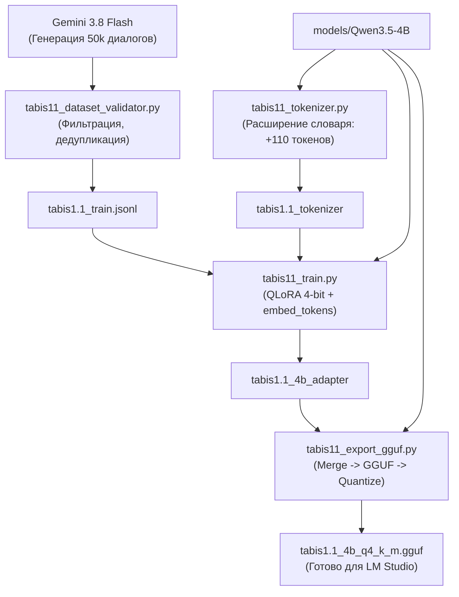

# НАУЧНО-ИНЖЕНЕРНЫЙ ПАЙПЛАЙН РАЗРАБОТКИ МОДЕЛИ «ТАБЫС 1.1» (TABIS 1.1 4B)

> **Проект:** Разработка суверенной билингвальной языковой модели «Табыс 1.1» (tabis1.1-4b) для малоресурсного якутского языка (саха тыла)  
> **Автор разработки:** Николаев Сарыал Павлович, 11 класс, МБОУ «Намская улусная гимназия им. Н.С. Охлопкова»  
> **Научный руководитель:** Сидоров Николай Семенович  
> **Среда:** Локальный стенд на базе NVIDIA GeForce RTX 5060 (8 ГБ VRAM)

---

## 1. Анализ фундаментальных проблем Tabis 1.0 и концепция версии 1.1

По результатам стресс-тестирования 150 протоколов версии `tabis1.0-4b` были вскрыты две коренные архитектурные причины лингвистических ошибок:

1. **Дефект обучающего датасета (Translation Paralysis):**
   * В версии 1.0 использовались параллельные книги и машинный перевод пар предложений («слово за словом»).
   * У модели отсутствовал опыт интерактивного диалога (Human-AI interaction), поэтому в свободной беседе она пыталась не отвечать собеседнику, а «допереводить» или дописывать текст как книгу.
2. **Феномен распада токенизатора на байты (High Byte-Level Fertility):**
   * В базовом токенизаторе Qwen символы `ҕ, Ҕ, ҥ, Ҥ, Ү` отсутствовали в словаре как самостоятельные единицы.
   * Слово `саҥа` дробилось на 4–6 субтокенов `[142, 98]`, заставляя модель угадывать байты UTF-8. Это приводило к зацикливанию (`4b 4b 4b...`) и лексическим галлюцинациям.

### Ключевые инновации Tabis 1.1:
* **Адаптация токенизатора (Vocabulary Extension):** Внедрение 110 специализированных якутских токенов (буквы + частотные аффиксы сингармонизма) со сжатием длины текста до 25.8%.
* **Фонетическая инициализация эмбеддингов:** Веса новых якутских букв инициализируются от родственных кириллических доноров (`ҕ` $\leftarrow$ `г`, `ҥ` $\leftarrow$ `н`, `Ү` $\leftarrow$ `У`) вместо случайного белого шума.
* **Масштабный диалоговый корпус (50 000 пар ChatML):** Разработанная матрица тем, имитирующая живое общение с носителем языка саха.
* **Обучение эмбеддингов в LoRA (`modules_to_save`):** Полная подгонка новых токенов под семантическое пространство Qwen.

---

## 2. Архитектура и пропорции обучающего датасета (50 000 диалогов)

| № | Категория | Доля | Кол-во диалогов | Описание и специфика |
| :-: | :--- | :-: | :-: | :--- |
| **A** | **Күннээҕи кэпсэтии (Бытовой диалог)** | **40%** | **20 000** | Живое общение: семья, школа, охота, рыбалка, погода, блюда якутской кухни, спорт, хобби. |
| **B** | **Култуура, устуоруйа уонна Саха сирэ** | **25%** | **12 500** | Олонхо, Ысыах, традиции, Ойунский, Аммосов, Кулаковский, улусы, география, Чысхаан. |
| **C** | **Тылбаас уонна быһаарыы (ru $\leftrightarrow$ sah)** | **20%** | **10 000** | Не просто перевод, а диалог: точный перевод + объяснение морфем, синонимов и культурного контекста. |
| **D** | **Үөрэх, логика уонна STEM** | **10%** | **5 000** | Решение математических задач, физика, биология Севера, логические загадки на якутском языке. |
| **E** | **Идентичность и безопасность** | **5%** | **2 500** | Автор Сарыал Николаев, Намская гимназия, отсутствие галлюцинаций, защита от взлома и джейлбрейков. |

---

## 3. Пошаговый регламент запуска пайплайна



### Шаг 1. Адаптация токенизатора и словаря
Выполняется локально за 10 секунд:
```powershell
python tabis11_tokenizer.py
```
* **Результат:** Папка `tabis1.1_tokenizer` с обновленным словарем (248 187 токенов). Буквы `ҕ, Ҕ, ҥ, Ҥ, Ү` и ключевые аффиксы закодированы как самостоятельные токены.

### Шаг 2. Генерация диалогов через Gemini 3.8 Flash
Шаблоны задач формируются скриптом:
```powershell
python tabis11_prompt_generator.py
```
Сгенерированные порции диалогов складываются в `raw_dialogues.jsonl`.

### Шаг 3. Валидация и фильтрация датасета
Автоматическое отсечение мусора, битых строк, иероглифов, зацикливаний и повторов:
```powershell
python tabis11_dataset_validator.py
```
* **Результат:** Чистые обучающий (`tabis1.1_train.jsonl`) и валидационный (`tabis1.1_val.jsonl`) файлы в строгом формате ChatML.

### Шаг 4. Обучение модели (SFT QLoRA 4-bit)
Обучение запускается на видеокарте RTX 5060:
```powershell
python tabis11_train.py
```
* **Особенности:** Используется 4-bit NF4 с оптимизацией `paged_adamw_8bit`. Параметр `modules_to_save=["embed_tokens", "lm_head"]` обучает новые якутские токены совместно с весами внимания.

### Шаг 5. Слияние адаптеров и квантование в GGUF
Финальный этап сборки готовой модели:
```powershell
python tabis11_export_gguf.py
```
* **Результат:** Файл `tabis1.1_4b_q4_k_m.gguf`, готовый к прямому переносу в LM Studio.

---

## 4. Ожидаемые научно-практические результаты Tabis 1.1

1. **Ликвидация зацикливаний:** Атомарные токены для `ҕ, ҥ, Ү` гарантируют, что модель никогда не будет генерировать повторяющиеся байт-коды.
2. **Ускорение инференса на 20–25%:** Сокращение количества токенов на фразу снижает задержку генерации (Time to Generate).
3. **Естественный диалоговый интеллект:** Переход на 50 000 живых диалогов обучит модель вести связную беседу, проявлять эмпатию и объяснять сложные концепты на родном языке саха.
